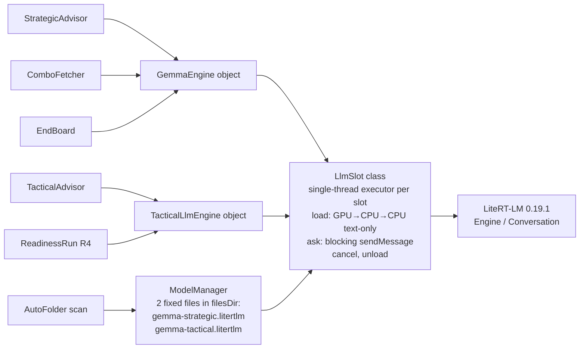

# Hybrid LiteRT-LM + GGUF Inference — Phase Zero Audit (read-only)

**Directive:** owner's "Hybrid LiteRT-LM + GGUF Inference Architecture".
**Author:** Claude Code, 2026-11-09.
**Status:** no source changed; awaiting owner authorization for Phase One.

All statements are VERIFIED by reading the code, the build files or the built APK on the date above, unless marked otherwise. Nothing was device-tested.

## 0.1 Repository

| Item | Value |
|---|---|
| Repository | https://github.com/georgenaval1-blip/Sphynx-Auto-Pilot |
| Authoritative branch / commit | `main` = `716af662b0239d567826c174a313696aa04defff` |
| Working tree | clean |
| Local branch | `docs/universal-compatibility-audit` (Stage 1 docs plus this file; not pushed) |
| Version | 37.19, versionCode 3719, applicationId `com.sphynx.autopilot`, namespace `com.example.mlbbresearch` |
| Toolchain | AGP 9.3.1, Kotlin 2.3.21 (via kotlin-gradle-plugin; AGP compiles Kotlin), Gradle 9.6.1, JDK 21 (CI), compileSdk / targetSdk 36, minSdk 30, JVM target 17 |
| Build and test baseline | `./gradlew testDebugUnitTest assembleDebug` → **168 tests, 0 failures, 0 skipped**; APK built |
| CI | `.github/workflows/android-build.yml`: assembleDebug + testDebugUnitTest; uploads test reports only, **not the APK** |
| How the owner builds | On the phone with **Code on the Go** (SETUP.md "Install into Code on the Go"; AndroidIDE notes in `app/build.gradle.kts` packaging) |

## 0.2 Current AI architecture

- **One inference class, `LlmSlot`** (`ai/GemmaEngine.kt`), with two singletons: `GemmaEngine` (strategic) and `TacticalLlmEngine` (tactical). Each has its own single-thread executor and thread priority: `NORM-1` for strategic, `MIN+1` for tactical.
- **Callers (11 files):**
  - `StrategicAdvisor`;
  - `ComboFetcher`;
  - `EndBoard`;
  - `TacticalAdvisor`;
  - `ReadinessRun`;
  - `AiRuntime`;
  - `MainActivity`;
  - `AutoFolder`;
  - `ModelManager`;
  - `Speed`;
  - `GemmaEngine` itself.

  Callers use `ask(prompt, image?, temperature)` → `String`, and `ready`, `visionOk`, `state`, `backendName`.
- **Generation is not streamed today:** blocking `sendMessage` on the slot's thread. Cancellation goes through `Conversation.cancelProcess()`.
- **Model storage:**
  - `AutoFolder` copies files from the chosen folder into `filesDir`, only when they changed (signature in `Cfg auto_sig_*`);
  - `ModelManager.isTactical(name, size)` picks the slot by **file name and size**: "270m" / "1b" / "tactic", or under 1 GB;
  - display names are kept in `Cfg` (`llm_name_strategic`, `llm_name_tactical`);
  - there is no registry, no metadata and no hash.
- **Persistence:** SharedPreferences through `core/Settings.kt` (`Cfg`). **No Room / database.** JSON files sit in `filesDir` for research data.
- **Concurrency:** `AiRuntime.scope` = `CoroutineScope(SupervisorJob() + Dispatchers.Default)`. Each LLM slot has its own dispatcher. There is no central admission or resource control. **Both models can be loaded at once with no memory check.**
- **Resource monitoring:** `core/DeviceStats.kt` *displays* CPU, GPU, RAM and storage (Speed page). There is no thermal API, no `onTrimMemory`, and no admission logic.
- **Safety boundary (unchanged by this work):**
  - the 270M's advice passes `TacticalAdvisor.check` and `DecisionValidator`, which marks it advisory-only (Experimental capability);
  - research R3 uses the arbiter only in verified practice;
  - nothing in the LLM layer sends touches.

## 0.3 Dependencies

| Library | Version | Used? | Native ABIs in the APK |
|---|---|---|---|
| `com.google.ai.edge.litertlm:litertlm-android` | **0.19.1 (pinned)** | yes, LLMs | arm64-v8a (21.6 MB), x86_64 (25.6 MB) |
| `org.tensorflow:tensorflow-lite` | 2.17.0 | yes, YOLO / FightNet / PolicyNet | arm64-v8a, armeabi-v7a, x86, x86_64 |
| `com.google.ai.edge.litert:litert` | 1.4.2 | **no import anywhere** | (no .so in the APK) |
| `kotlinx-coroutines-android` | 1.10.2 | yes | — |
| llama.cpp / GGUF | — | **none** | — |
| Native C/C++ / JNI / CMake / NDK config | — | **none in the repo** | — |

**LiteRT-LM 0.19.1 already provides, but the app does not use** (found by reading the AAR's class signatures):
- `Conversation.sendMessageAsync(…, MessageCallback{onMessage, onDone, onError})` for **streaming**;
- `Backend.NPU(nativeLibraryDir)` and `NpuBrand` (QUALCOMM, MEDIATEK, GOOGLE_TENSOR, SAMSUNG, INTEL);
- `ModelInfo.from(path)`, with `supportedBackends(modality)`, `maxContextTokens()`, `inputModalities()`, `npuBrand()`, `minRuntimeVersion()`. This allows **metadata and compatibility checks without loading the model**;
- `SamplerConfig`, `RepetitionPenaltyConfig`, `ThinkingConfig`, `Session`, `BenchmarkInfo`.

**Environment** (for the GGUF phase):
- llama.cpp is reachable by git (`git ls-remote` OK);
- the NDK is **not installed** here, but it can be installed with sdkmanager (NDK 30.0.16248370 stable, CMake 3.22–3.31 listed);
- CI has no NDK step yet.

## 0.4 Reusable components / gaps / conflicts

**Reusable:**
- `LlmSlot`, which becomes the LiteRT-LM backend;
- the GPU→CPU fallback order;
- the single-thread slot model;
- `AutoFolder`'s change detection and streaming copy;
- `Storage`;
- `DeviceStats`, as raw readings;
- `universal/Capabilities`;
- the research and readiness harness (`TacticalReadiness`) for comparing backends.

**Missing:**
- an inference interface;
- a model registry and metadata;
- GGUF parsing;
- the llama.cpp native layer;
- a resource and admission manager;
- assignment UI;
- streaming;
- a load sentinel.

**Conflicts and limitations:**
1. Slot by file-name heuristic. Replaced by explicit assignment, keeping the heuristic as migration for existing installs.
2. The folder scan auto-loads models at startup. This conflicts with "avoid loading large models automatically". It needs a policy change that the owner approves.
3. Callers depend on the singletons `GemmaEngine` and `TacticalLlmEngine` directly. They keep their names as **facades** that delegate to the assigned backend, so the 11 caller files barely change.
4. Vision prompts (Gemma images: draft and line-up reading) exist only on LiteRT-LM multimodal models. A GGUF strategic model is **text-only** unless a multimodal GGUF plus projector is supported; that's to verify. The app must then disable vision features, which it already does when `visionOk = false`.

## 0.5 Files likely to change (Phases One to Seven)

| Phase | Changes |
|---|---|
| One | New package `inference/`: `InferenceBackend`, `ModelConfiguration`, `InferenceRequest`, `InferenceEvent`, `RuntimeStatus`, `InferenceError`, `BackendType`. Pure Kotlin. |
| Two | `ai/GemmaEngine.kt` (`LlmSlot` → `LiteRtLmBackend`, adding streaming and NPU attempts). `GemmaEngine` and `TacticalLlmEngine` stay as facades. |
| Three | New `app/src/main/cpp/` (JNI bridge + CMake), llama.cpp at a **pinned commit**, `app/build.gradle.kts` (externalNativeBuild, ndkVersion, ABI filter arm64-v8a first), CI workflow (NDK setup), new `inference/LlamaCppBackend.kt`, `inference/GgufReader.kt` (pure Kotlin header parser). |
| Four | `models/ModelManager.kt` → `models/ModelRegistry.kt` (JSON in `filesDir`, no database), `models/AutoFolder.kt` (both formats, plus SAF import with progress). |
| Five | `ai/StrategicAdvisor.kt`, `ai/TacticalAdvisor.kt`, `ai/ComboFetcher.kt`, `vision/EndBoard.kt`, `research/ReadinessRun.kt` (through the facades), `core/Settings.kt` (assignments). |
| Six | New `inference/ResourceManager.kt` (admission, states registered / loaded / active, thermal via `PowerManager`, `onTrimMemory` in `MainApplication`). |
| Seven | `app/MainActivity.kt` Model page: library, import, assignment, runtime settings. The rest of the UI is untouched. |
| Eight | New JVM tests, plus device checks listed separately. |

## 0.6 Risks

| # | Risk | Severity | Proposal |
|---|---|---|---|
| R1 | **Owner builds on the phone (Code on the Go).** Compiling llama.cpp needs the NDK, CMake and a long C++ build that may not work in Code on the Go. | **High — blocking decision** | Choose an option (§0.8 Q1). |
| R2 | APK size: llama.cpp adds a native library per ABI (size TO MEASURE; likely several MB per ABI) on top of LiteRT-LM's 21.6 MB (arm64) | Medium | arm64-v8a only at first; split ABIs later. |
| R3 | Native crashes in llama.cpp or LiteRT-LM GPU/NPU cannot be caught by Kotlin | High | Load sentinel + per-model, per-backend blocklist (from Stage 1 Phase C/E); never auto-load a model that crashed. |
| R4 | Memory: two models + KV caches; file size underestimates the RAM needed | High | Admission estimate = file size × format factor + KV cache (context × layers × heads); conservative until measured on the device. |
| R5 | GGUF breadth: architectures, tokenizers and chat templates vary by llama.cpp version | Medium | Pin the llama.cpp commit; check `general.architecture` against the pinned build's supported list; use the model's `tokenizer.chat_template` when present; otherwise refuse with a clear message. |
| R6 | GGUF strategic models lose image input (draft and line-up reading) | Medium | Shown in the UI as "text only"; vision features fall back as they do today. |
| R7 | Overlap with Stage 1 phases B–G | Low | This directive implements B (contracts), D (runtimes), E (registry) and F (resources) for LLMs; C (capability manager) supplies the device evidence. No duplicate work. |
| R8 | 270M safety boundary | — | Unchanged: assignment changes *which file* backs the tactical engine, never what its advice may do. |

## 0.7 Proposed implementation sequence

Phases follow the owner's numbering. One change is recommended.

1. **Phase One:** contracts (pure Kotlin, unit tested). No behaviour change.
2. **Phase Two:** wrap `LlmSlot` as `LiteRtLmBackend`, with facades; add streaming, `ModelInfo` validation and the load sentinel. Existing behaviour stays identical.
3. **Phase Three, split in two:**
   - **3a — feasibility spike** (recommended to move up, right after Phase One): build a minimal llama.cpp JNI library for arm64-v8a in CI, load a tiny GGUF in an instrumented check, and report APK size and build time.
   - **3b — full backend.** Only after 3a passes, and after the owner chooses the build option.
4. **Phase Four:** registry + GGUF header reader (pure Kotlin) + import.
5. **Phase Five:** assignment.
6. **Phase Six:** resource manager.
7. **Phase Seven:** UI.
8. **Phase Eight:** tests and device validation.

**Why 3a moves up:** everything after Phase Two only makes sense if llama.cpp can be built and shipped in the owner's build setup. Finding that out first avoids building model-management UI for a backend that can't ship.

## 0.8 Owner decisions needed before Phase One

1. **Build path for native code (R1):**
   - (a) **Recommended:** CI builds the llama.cpp `.so` for arm64-v8a and attaches the app APK as a downloadable artifact. The owner installs the CI-built APK.
   - (b) CI builds only the `.so`, which is committed under `jniLibs/` at a pinned version. Phone builds keep working with no NDK; the repository holds a few MB of binaries per update.
   - (c) Try building in Code on the Go with its NDK support (uncertain).
2. **Model storage:** keep **copying into app storage** (today's reliable approach, with a free-space check before copying), or also allow referencing files in place through SAF. Recommendation: copy (current), with a storage check; references later if needed.
3. **Auto-load at startup:** today the folder scan loads models automatically. Should loading become an explicit action, or stay automatic but go through the resource manager's admission check? Recommendation: admission-checked auto-load.
4. **Moving Phase 3a up** (the feasibility spike right after Phase One).

## 0.9 Owner answers (2026-11-09)

| Question | Answer | Effect on the plan |
|---|---|---|
| 1. Native build path | **No preference yet** | Decided after the Phase 3a spike. The spike measures the CI-built APK and the CI-built `.so` (committed) options; Code on the Go NDK is tried only if the owner asks. |
| 2. Model storage | **Both, chosen per model at import** | The registry stores either an app-storage copy (with a free-space check first) or a SAF document reference (persistable permission; reported as unavailable if the original is moved or deleted). Originals are never deleted. |
| 3. Startup loading | **Auto-load after a memory check** | Assigned models load at start only when the resource manager admits them; otherwise they wait and the app shows why. |
| 4. Order | **Spike first (3a right after Phase One)** | Sequence: One → 3a → Two → 3b → Four → Five → Six → Seven → Eight. |

Implementation still requires the owner's explicit "authorize Phase One".

## 0.10 Owner priority (2026-11-09): the app must build and install with Code on the Go

This is a **hard constraint on every phase**:
- Nothing may require the NDK, CMake or a C++ compile in the owner's build. Code on the Go must keep building the APK from this repository as it does today.
- Native build path resolved to **option (b)**. llama.cpp's `.so` is compiled by CI at a pinned commit (arm64-v8a) and committed under `app/src/main/jniLibs/`. Code on the Go only packages it, the same way it packages LiteRT-LM's native libraries from the AAR today.
- **Phase 3a pass/fail criterion:** the spike branch must build and install in Code on the Go, confirmed by the owner on the POCO X6 Pro. If not, GGUF is postponed and the LiteRT-LM phases continue without it.
- Every phase's PR states: "Code on the Go build: confirmed / pending owner check".

