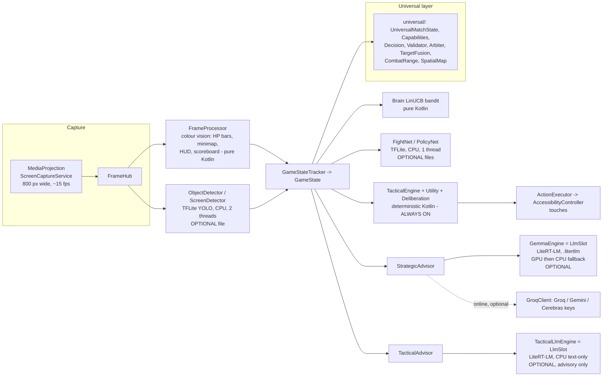
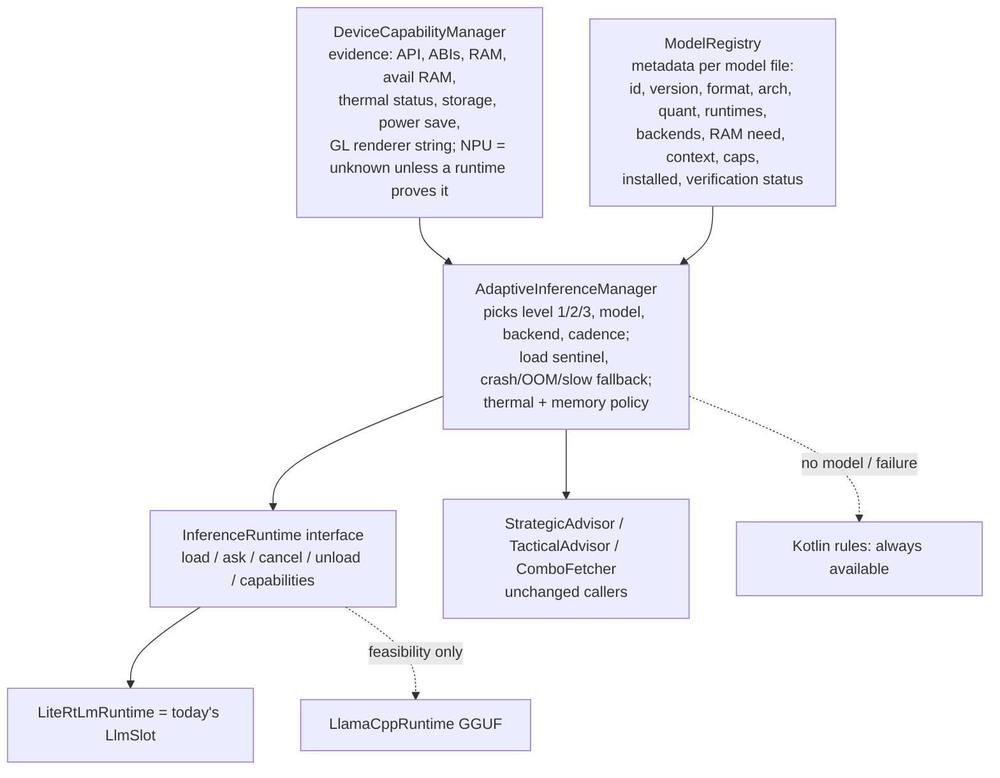

# Sphynx Auto-Pilot — Universal Device Compatibility & Adaptive Intelligence

**Phase A report (read-only audit) and roadmap integration.** Written by Claude Code on 2026-11-09, at `origin/main` = `716af66`.

The audit looked only at what the repository actually contains: source, build files and the built APK. Nothing was tested on a device. Labels follow `DEVELOPMENT_STATUS.md`:

| Label | Meaning |
|---|---|
| VERIFIED | Checked against code, a build, a test run or CI. |
| REPORTED | Stated by someone; not re-checked here. |
| PROPOSED | Suggested; not approved. |
| BLOCKED | Waiting on something named. |
| REQUIRES TESTING | Needs a real device. |

> **Guiding rule (owner, 2026-11-09):** the device decides *how much* intelligence runs locally. It never decides *whether* Sphynx works.

---

## A.1 Current architecture (VERIFIED by code reading)

What runs **with no model at all**:
- capture, colour vision and game state;
- the Kotlin tactical engine and the Brain;
- Player mode in "rules only" (`AiRuntime.kt:108`);
- Drafter in non-ranked;
- research mode;
- the session recorder.

Every AI model is an **optional file** found by `models/AutoFolder.kt`.

## A.2 AI dependency map (VERIFIED)

| Component | Runtime / library | Where | Backend | Required? |
|---|---|---|---|---|
| Strategic LLM (Gemma 4 E2B / 3n E2B) | LiteRT-LM `litertlm-android:0.19.1` (pinned) | `ai/GemmaEngine.kt` (`LlmSlot`), `models/ModelManager.kt` | GPU first (`Cfg.useGpu` default **true**), then CPU, then CPU text-only | Optional for play. **Required to start Builder, and Drafter in Ranked** (`AiRuntime.needsGemma`, `AiRuntime.kt:115`) |
| Tactical LLM (Gemma 3 270M) | LiteRT-LM | same `LlmSlot`, `TacticalAdvisor` | CPU, text only | Optional; advisory only (validator: Experimental) |
| Minimap / screen detector (YOLO) | TensorFlow Lite `tensorflow-lite:2.17.0` | `vision/ObjectDetector.kt:74` | CPU, `setNumThreads(2)` | Optional |
| Fight-choice network | TFLite | `learning/FightNet.kt:53` | CPU, 1 thread | Optional |
| Tactical policy network | TFLite | `learning/PolicyNet.kt:174` | CPU, 1 thread | Optional |
| Online LLMs | HTTPS (Groq, Gemini, Cerebras) | `ai/GroqClient.kt` | remote | Optional (needs a key file) |
| `com.google.ai.edge.litert:litert:1.4.2` | — | **no import anywhere** | — | **Unused dependency** |

All LLM calls go through one class, `LlmSlot`, which has:
- `load` with a backend fallback list;
- `ask`, single-threaded;
- `cancel` and `unload`.

That makes it the natural seam for a runtime abstraction. Only 6 files call `GemmaEngine.*` directly:
- `StrategicAdvisor`;
- `AiRuntime`;
- `ComboFetcher`;
- `MainActivity`;
- `AutoFolder`;
- `ModelManager`.

## A.3 Device-specific assumptions found (VERIFIED)

| # | Finding | Where | Impact on compatibility |
|---|---|---|---|
| 1 | **LiteRT-LM ships native code for arm64-v8a and x86_64 only.** TFLite also ships armeabi-v7a and x86. | built APK `lib/` | On 32-bit ARM phones the LLMs cannot run; the detectors and networks can. `LlmSlot.load` catches `Throwable`, so it *should* fail softly — REQUIRES TESTING. |
| 2 | `minSdk = 30` (Android 11), target 36 | `app/build.gradle.kts:52` | Android 8–10 devices cannot install. Lowering it touches MediaProjection, storage and accessibility code — owner decision. |
| 3 | GPU is tried first for the strategic model by default | `Settings.kt:32`, `ModelManager.load` | Good when it works. A *native* crash in a GPU driver is not catchable (see 5). |
| 4 | Fixed capture size (800 px), fixed frame gap (66 ms; 33 ms "fast mode") | `FrameHub.CAPTURE_WIDTH`, `ScreenCaptureService.kt:40` | No adaptation to slow CPUs or to heat. |
| 5 | **No crash-loop protection.** A native crash during model load kills the app; the next start re-runs the folder scan, which loads the model again. | `AutoFolder.kt:243-263` | A device that crashes on GPU load could crash on every start. Highest-priority gap. |
| 6 | **No memory budget.** The folder scan loads the big model whatever the free RAM is; both LLMs can be loaded at once. `largeHeap="true"`. | `AutoFolder.kt`, `AndroidManifest.xml:28` | Out-of-memory kills likely on 4–6 GB devices — REQUIRES TESTING. |
| 7 | **No thermal or memory-pressure handling.** No `PowerManager.getCurrentThermalStatus`, no `onTrimMemory`. `DeviceStats` only *displays* CPU, GPU, RAM and storage. | `core/DeviceStats.kt` | Sustained play can throttle; the app does not react. |
| 8 | Fixed inference cadence: strategy every 8 s (`strategyEverySec`), builder screen read every 25–30 s, small model ~3 Hz in fights | `Settings.kt:45,223`, `TacticalAdvisor` | No scaling by device class. |
| 9 | Hardware facts are read for display only (CPU clocks from `/sys`, GPU vendor files that many phones block) | `DeviceStats.kt` | Fine for display. **Not** evidence of usable acceleration. |
| 10 | Measured on the owner's POCO X6 Pro (Dimensity 8300-Ultra, Mali-G615), from the 2026-11-08 recordings: frame-to-touch about **310 ms average**; the touch queue alone 160–320 ms; vision 26–80 ms | session recordings, Speed log | The bottleneck on this phone is touch dispatch, not inference. |

## A.4 Compatibility gap analysis (against the owner's 15 principles)

| Principle | Status today |
|---|---|
| 1–4. No mandatory Snapdragon / MediaTek / Adreno / Mali | **Met.** Nothing is vendor-specific. |
| 5–6. No mandatory NPU / GPU | **Met for play.** The GPU is preferred, with a CPU fallback. |
| 7. CPU-only operation | **Met in code.** REQUIRES TESTING on a CPU-only device. |
| 8. Local LLM optional | **Partly met.** Builder and Ranked Drafter refuse to start without Gemma. |
| 9. Core works without an LLM | **Met for play, research and recorder.** Not met for Builder and Ranked Drafter (see 8). |
| 10. Runtimes replaceable | **Not met.** LiteRT-LM types are used directly in `LlmSlot`. |
| 11. Models replaceable without logic changes | **Partly met.** Any `.litertlm` loads, but the slot is chosen by file name and size (`ModelManager.isTactical`). There is no metadata. |
| 12. Graceful degradation | **Partly met.** Kotlin errors fall back; native crashes and crash loops do not. |
| 13. Evidence-based hardware detection | **Not met.** No capability detection exists. |
| 14. Compatibility-based model selection | **Not met.** Selection is by file name and size. |
| 15. Optimisation must not break features | Process rule; to be kept by tests. |

## A.5 Risk assessment

| Risk | Likelihood | Severity | Mitigation (phase) |
|---|---|---|---|
| Crash loop after a native model-load crash | Medium on unknown GPUs | High | Load sentinel + per-backend blocklist (Phase E, **pull forward**) |
| OOM when loading Gemma 4 E2B on 4–6 GB phones | Medium | High | Memory budget before load (C + E) |
| Abstraction that adds layers without value | Medium | Medium | One interface around `LlmSlot`, no framework (B) |
| llama.cpp needs an NDK build, JNI and its own release process | High if attempted | Medium | Feasibility spike only, behind the adapter; no dependency until justified (D) |
| Changing defaults breaks the owner's tuned MLBB behaviour | Low–medium | High | Defaults on the POCO profile must stay identical; regression tests, recordings (all phases) |
| Claims of acceleration without evidence | — | Medium | "Verified" only after a real inference on that backend (C, G) |

## A.6 Proposed architecture (PROPOSED — design only, not implemented)

The aim is small and additive. The existing classes stay; new code wraps them.

**Intelligence levels** are computed from measured evidence, never from brand names.

| Level | Typical evidence | Intelligence |
|---|---|---|
| 1 Basic | No 64-bit LLM runtime, or less than about 6 GB total RAM, or thermal SEVERE+, or no model installed | Kotlin rules; optional TFLite nets on CPU; no local LLM, or the 270M only if its memory budget fits; strategy cadence relaxed |
| 2 Enhanced | arm64, enough *available* RAM for the strategic model plus headroom; CPU inference verified | Gemma on CPU (or GPU if verified); current cadence |
| 3 Advanced | Level 2 plus GPU (or NPU) inference **verified by a successful run** on this device, and thermal status NONE or LIGHT | Today's POCO behaviour: GPU Gemma, vision prompts, the 270M alongside |

All RAM thresholds are placeholders until Phase G measures them; they are not a claim. The level is re-evaluated when the thermal status or available memory changes.

**Graceful degradation, in order:**
1. Detect: exception, timeout, latency above budget, OOM signal, or a sentinel left by a crash.
2. Cancel the operation.
3. Keep the session.
4. Try the next backend or model.
5. Fall back to Kotlin.
6. Show the reduced level on the Speed / Model page.
7. Persist a per-model, per-backend blocklist so the same crash is not retried on start.

**LiteRT-LM compared with llama.cpp** (to verify in Phase D; not claims):

| | LiteRT-LM (in use) | llama.cpp (candidate) |
|---|---|---|
| Model format | `.litertlm` (Gemma family published by Google) | GGUF (many families) |
| Android packaging | Maven AAR (used today) | No official AAR; NDK build + JNI, or a community wrapper |
| ABIs today | arm64-v8a, x86_64 (VERIFIED in our APK) | Builds for arm64 and others; 32-bit ARM support and speed to verify |
| GPU | GPU backend used today; works on the owner's Mali (REPORTED: "ready on GPU") | Vulkan / OpenCL backends; per-vendor maturity to verify |
| Vision input | Yes (Gemma 4 E2B / 3n images) — used for draft and line-up reading | Multimodal support varies by model and build |
| Cost to add | — | APK size, build time, a second prompt format, maintenance |

Recommendation: keep LiteRT-LM as the only runtime. Add llama.cpp only if Phase G shows a real device class that LiteRT-LM cannot serve. 32-bit ARM is the prime candidate to check.

## A.7 Roadmap integration

How the new phases relate to the existing plan. Nothing is removed. The full table is in `DEVELOPMENT_STATUS.md` §8.

- **Phase A** (this document): Completed, read-only.
- **Phase B** (runtime-independent contracts): a specification only. It extends the existing `universal/` package (Decision, Capabilities), so no parallel framework is created.
- **Phase C** (Device Capability Manager): first code phase. Pure detection plus display; no behaviour change.
- **Pulled forward from Phase E: the load sentinel / crash-loop guard.** It is the only item that protects users *today*, and it is tiny. It is proposed as the first item of Phase C or a separate small PR.
- **Phase D** (runtime abstraction): wraps `LlmSlot` behind an interface. llama.cpp is a feasibility spike only.
- **Phase E** (model registry and adaptive manager): replaces file-name slot guessing with metadata. It also needs the owner's decision on Builder and Ranked Drafter without Gemma (principle 9).
- **Phase F** (resource and thermal): cadence and capture scaling.
- **Phase G** (device validation): BLOCKED on access to devices other than the POCO X6 Pro.

**Existing work keeps its priority.** Issue #2 re-test, R5 tuning (needs 5 or more practice matches per group), R4 readiness (needs 200 or more moments) and map validation (needs screenshots) are all waiting on device data. Phases B and C do not compete with them for the owner's time.

## A.8 Testing plan per phase (summary)

Each phase adds JVM unit tests for the following, using fakes; no device needed:
- classification;
- registry validation;
- the fallback order;
- the sentinel logic;
- the thermal and memory policies.

The existing suite (168 tests, VERIFIED on `716af66`) must stay green. Real-device checks are listed separately and are never reported as passed without a device run.
